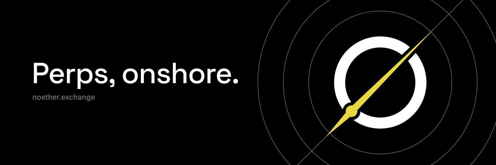

 
 

**The perpetual exchange built to come onshore.** The same perps traders love, on a venue built to stay. Noether runs on Stellar: positions, liquidity and settlement live in Soroban smart contracts.

[Website](https://noether.exchange) · [Trade on testnet](https://testnet.noether.exchange) · [Docs](https://docs.noether.exchange) · [X](https://x.com/Noetherdex)

## Repositories

**[noether-contracts](https://github.com/NoetherDEX/noether-contracts)** The protocol's Soroban smart contracts: market, vault, router, vault factory and referral.

**[noether-docs](https://github.com/NoetherDEX/noether-docs)** The source of [docs.noether.exchange](https://docs.noether.exchange): trading guides, protocol docs and the developer reference.

## Build on Noether

| Tool | Links |
| :--- | :--- |
| TypeScript SDK | [`noether-sdk` on npm](https://www.npmjs.com/package/noether-sdk) · [Guide](https://docs.noether.exchange/developers/sdk-ts) |
| Python SDK | [`noether-sdk` on PyPI](https://pypi.org/project/noether-sdk/) · [Guide](https://docs.noether.exchange/developers/sdk-py) |
| REST and WebSocket API | [REST reference](https://docs.noether.exchange/developers/rest-api) · [WebSocket reference](https://docs.noether.exchange/developers/websocket) |
| Contract addresses | [Deployed contracts](https://docs.noether.exchange/protocol/contracts) |

## Security

Please report vulnerabilities privately to **security@noether.exchange**, not in a public issue. The full policy is in [SECURITY.md](https://github.com/NoetherDEX/noether-contracts/blob/main/SECURITY.md).

 

  <picture>
    <source media="(prefers-color-scheme: dark)" srcset="https://raw.githubusercontent.com/NoetherDEX/.github/main/profile/assets/noether-mark-white.svg">
    
  </picture>

Funded by the Stellar Community Fund (SCF #41). Named after Emmy Noether, who proved that every symmetry implies a conservation law.

